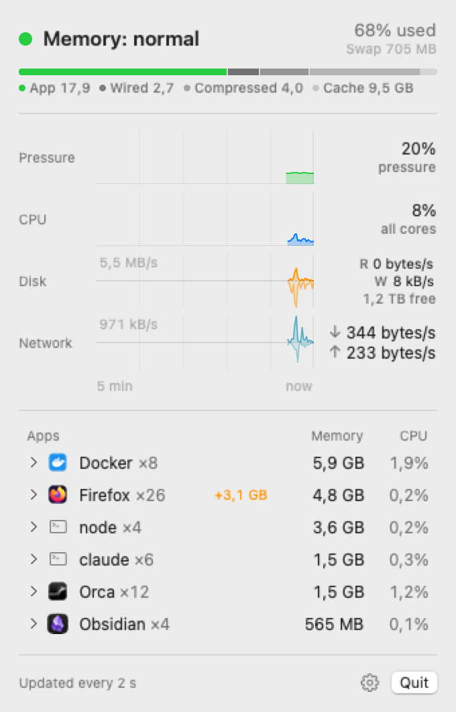

# Pulsebar

A small native macOS menu bar utility that shows real system load: memory pressure, the apps using the most memory and CPU, disk and network throughput, and the health of your homelab servers.

The menu bar shows a pressure dot, memory used % and total CPU %, e.g. `● 62% [cpu] 14%`. Click it to open the timeline panel.

Requires macOS 14+. Menu-bar only (`LSUIElement`), no Dock icon.

<picture>
  <source media="(prefers-color-scheme: dark)" srcset="docs/images/panel-dark.png">
  
</picture>

## Install

Download the latest `Pulsebar-<version>.zip` from [Releases](https://github.com/mswiszcz/pulsebar/releases), unzip, move `Pulsebar.app` to `~/Applications`, open it.

> [!warning] Not notarized
> Release builds are ad-hoc signed, so macOS blocks the first launch. Click **Open Anyway** in System Settings › Privacy & Security, or run `xattr -dr com.apple.quarantine ~/Applications/Pulsebar.app`.

Every push to `main` publishes a release (`.github/workflows/release.yml`): lint, test, universal build, zip, GitHub release `v0.1.<run number>`.

## Build, run, install

Works with the Command Line Tools alone (no Xcode).

| Command | What it does |
| --- | --- |
| `make build` | `swift build -c release`, assembles `build/Pulsebar.app`, ad-hoc signs it |
| `make run` | builds and opens the app |
| `make install` | builds and copies it to `~/Applications/Pulsebar.app` |
| `make test` | runs the unit tests |
| `make lint` | `swift format lint --strict` on the sources and tests |

`make build` options: `VERSION=0.1.5 BUILD_NUMBER=5` stamp the bundle version; `ARCHS="arm64 x86_64"` builds a universal binary (needs full Xcode, as on the CI runner).

> [!warning] Run tests through `make test`
> With only the Command Line Tools installed, plain `swift test` builds the tests and then silently runs **zero** of them, because SwiftPM can't find `Testing.framework` on its own. `make test` passes the framework search path and rpath.

Quit from the panel's **Quit** button (⌘Q while it is open). The gear button next to it opens Settings (⌘,).

## Settings

| Setting | Default | What it does |
| --- | --- | --- |
| Launch at login | off | Registers the app with `SMAppService.mainApp`. If macOS asks for approval, Settings shows a button to System Settings › General › Login Items |
| Notify when memory is under pressure | on | Posts a notification when pressure stays elevated (see [[#Pressure alerts]]) |
| Notify at | Warning | **Warning** or **Critical only** |
| Servers | none | Homelab servers shown in the panel. See [[#Homelab servers]] |

> [!important] Login item needs the installed copy
> Enable *Launch at login* from `~/Applications/Pulsebar.app` (`make install`), not from `build/`. The login item records the path of the copy that registered it, and `make build` replaces `build/Pulsebar.app` every time.

## What the numbers mean

Pulsebar samples every 2 s. Rates (CPU per app, disk, network) are deltas between two samples, so they show `—` for the first 2 s.

### Menu bar

- **Dot**: the kernel's memory pressure level. Green = normal, yellow = warning, red = critical.
- **First %** (after the `memorychip` symbol): memory used (see below) as a share of physical RAM.
- **Second %** (after the `cpu` symbol): total CPU busy time (user + system) across all cores.
- Numbers are padded with figure spaces so the label keeps the same width as values change. The padding goes before each symbol, so every symbol stays next to its number.

## The panel

The panel is a timeline. Four tracks share one time axis covering the last 5 minutes (150 samples, 2 s apart). The newest sample is at the right edge, marked by a faint "now" line. Faint vertical ticks mark each minute, and a ruler under the tracks reads "5 min … now". A spike in one track lines up with what the other tracks were doing at that moment. History is kept in memory only, and the tracks start empty after launch and fill in from the right.

| Part | Shows |
| --- | --- |
| Header | Pressure verdict ("Memory: normal" / "under pressure" / "critical") with the level dot. On the right: memory **used %** (the same number as the menu bar) and swap used |
| Memory bar | Physical RAM split into App / Wired / Compressed / Cache / free (the empty part), with a legend in GB |
| Pressure track | Pressure % (100 − `kern.memorystatus_level`), colored by the pressure level at each sample, labeled "pressure" |
| CPU track | Total CPU busy %, labeled "all cores" |
| Disk track | Read above the center line, write mirrored below (lighter), with current R / W rates and free space on `/` |
| Network track | Down above the center line, up mirrored below, with current ↓ / ↑ rates |
| Apps | The top 6 apps by memory plus the top 3 by CPU, sorted by memory. Shows the app icon (a terminal symbol for non-bundle processes), `×N` processes, memory (GB with one decimal, MB as whole numbers) and CPU as a share of all cores (orange once an app uses more than one full core). CPU shows `—` until the second sample. Clicking a row expands its processes (see [[#App details]]) |

Each track is a single VoiceOver element. It reads the track name, the current value and the 5-minute min–max range. App rows read as "Docker, 8 processes, 5.8 GB memory, 2.3% CPU", plus "grew 1.2 GB in 10 minutes" when flagged, and report expanded / collapsed.

> [!note] Rate tracks use a square-root scale
> Disk and network tracks scale to the highest value in the window, but never below a floor: 1 MB/s for disk, 100 KB/s for network. That way 1–2 KB/s of idle chatter stays a sliver instead of filling the track. Read/write (or down/up) share one scale, and the current full-scale value is shown faintly at the top left of the graph. Heights are the square root of value ÷ full scale. On a linear scale, a single 50 MB/s burst flattens a steady 100 KB/s to a line on the baseline. A log scale makes idle noise look like activity and needs an arbitrary floor. Square root keeps spikes as the tallest marks but leaves the baseline activity visible.

### Memory

| Row | Meaning | Source |
| --- | --- | --- |
| Pressure | Normal / Warning / Critical | `kern.memorystatus_vm_pressure_level` |
| Available to apps | The kernel's "memory free %" | `kern.memorystatus_level` (same as `memory_pressure -Q`) |
| Used | App memory + Wired + Compressed, same as Activity Monitor | `host_statistics64(HOST_VM_INFO64)` |
| App memory | Anonymous pages minus purgeable pages | `internal_page_count − purgeable_count` |
| Wired | Memory the kernel can't page out | `wire_count` |
| Compressed | Physical memory the compressor occupies | `compressor_page_count` |
| Cached files | File-backed and purgeable pages that macOS can drop at any time | `external_page_count + purgeable_count` |
| Swap | Swap file usage | `vm.swapusage` |

> [!note] Why "Used" can be high while pressure is green
> **Used** counts what's taking up RAM right now. macOS tries to keep RAM full and compresses memory before it swaps, so a high Used % on its own isn't a problem.
>
> **Pressure** and **Available to apps** (`kern.memorystatus_level`) are the kernel's own view of how much memory it can still hand out. That includes cached files it can drop and memory it can still compress. This is the number behind Activity Monitor's pressure graph.
>
> If you see 67% used and 17% pressure (83% available) at the same time, that's normal. Start worrying when the dot turns yellow or red, pressure climbs and swap keeps growing.

### Apps

App memory is the total **memory footprint** (`ri_phys_footprint`, the "Memory" column in Activity Monitor). This includes compressed memory, so it can differ from RSS in `ps`.

Processes are grouped into apps by their launch path:

- If the path is inside a `.app` bundle, the **outermost** bundle names the app. Firefox's `plugin-container.app` helpers count as **Firefox**, and Docker's `com.docker.sailor` counts as **Docker**.
- Otherwise the executable's file name is used: `node`, `bun`, `claude`.
- `×N` is the number of processes grouped into the app.

The launch path comes from `KERN_PROCARGS2` (the path that was exec'd, before symlinks are resolved). `proc_pidpath` is only a fallback, because it resolves symlinks. For example, `~/.local/bin/claude` would otherwise show up as its versioned target `2.1.296`.

The app is looked up on a process's first two samples, then cached by pid + start time until the process exits, so a steady sample only costs one `proc_pid_rusage` call per process. The second lookup catches wrapper scripts that `exec` the real binary right after starting. A process that `exec`s a different binary more than 2 s after starting keeps its earlier app.

### App details

Click an app row to expand it. The chevron turns down and up to 5 of the app's processes are listed by memory, with memory and CPU:

| App kind | Each line shows |
| --- | --- |
| Bundle app | Role and uptime: `Renderer`, `GPU`, `Network Service` (Chromium/Electron `--type`, `--utility-sub-type`), `Web Content`, `Media Decoder` (Firefox `-contentproc` kind), otherwise the executable name |
| Non-bundle tool (`claude`, `node`, `bun`, `python`) | Working directory, `~`-abbreviated to the last two components (`~/Labs/storykit`), and uptime |
| Docker | Running containers by memory (see [[#Docker]]) |

The expansion ends with an **Open in Activity Monitor** link.

Roles come from the launch arguments (`KERN_PROCARGS2`) and are cached per pid + start time. The working directory is `proc_pidinfo(PROC_PIDVNODEPATHINFO)`, and uptime comes from the start time in `PROC_PIDTBSDINFO`. These lookups run only for the listed apps and only while the panel is open.

### Growth badge

Every 30 s Pulsebar records the memory of each app using ≥ 100 MB, keeping the last 20 records (about 10 minutes). An app that grew by ≥ 500 MB since its oldest record gets an orange badge beside its memory: `+1.2 GB / 10 min`, shortened to `+1.2 GB` when the row is too narrow. An app that appeared during the window is measured from its first record.

### Docker

Docker's row lists running containers with memory and CPU, read from the Docker Engine API over the Unix socket `~/.docker/run/docker.sock` (falling back to `/var/run/docker.sock`): `GET /containers/json`, then `GET /containers/{id}/stats?stream=false&one-shot=true` per container, sent as plain HTTP/1.0.

- **Memory** is `usage − inactive_file` (`total_inactive_file` on cgroup v1), the same number as `docker stats`.
- **CPU** is the change in container CPU time between two polls, as a share of all host cores like the app rows. `docker stats` shows the same value as a percentage of one core.
- Polled every 15 s, on its own task, only while the panel is open or Docker is a top app. Opening the panel polls right away when the last poll is older than 15 s. If the socket doesn't answer, the row says "Docker not reachable".

## Pressure alerts

When the pressure level rises to warning or critical and stays there for 10 s, Pulsebar posts a notification that names the culprit:

- the biggest grower, if one grew ≥ 500 MB: "Memory under pressure — Firefox grew 3.1 GB in 10 min"
- otherwise the biggest app: "Memory under pressure — Docker uses 5.8 GB"

It notifies once per escalation. Critical after a warning notifies again, but repeated swings between warning and normal don't. It re-arms only after pressure has been back at normal for 60 s. "Used %" never triggers an alert. Clicking the notification opens the panel.

Notification permission is requested at launch while notifications are enabled, and again when you switch them back on.

> [!info] Only your own processes
> Pulsebar runs without root, so it can't read other users' or root processes (`WindowServer`, `kernel_task`, system daemons). It skips them silently, so these lists only cover your own apps.

### CPU

- **Total**: share of all CPU ticks that were user or system time since the last sample (`host_processor_info`). It should match the user + sys figures in `top`.
- **Per app** (Apps list): CPU time used during the last interval (`ri_user_time + ri_system_time`), divided by the number of logical cores. It's a share of the whole machine, comparable with Total: an app pinning one core on a 14-core Mac shows about 7%. An app joins the list for CPU only if it's above 0%.

### Disk

- **Free**: available capacity of `/` "for important usage" (it counts purgeable space macOS can reclaim, like Finder does), out of the total. Refreshed every 30 s, because each lookup goes through the `CacheDelete` service.
- **Read / Write**: throughput summed over all `IOBlockStorageDriver` devices.

### Network

**Down / Up**: bytes/s summed over all non-loopback interfaces. Uses the 64-bit counters from `NET_RT_IFLIST2`. Note that traffic through a VPN `utun` interface also passes through the physical interface, so it can be counted twice.

## Homelab servers

The panel has a **Homelab** section between Apps and the footer. It appears when at least one server is configured. It shows CPU, RAM, VRAM, uptime and status for each server, next to the Mac's own numbers.

Each server is one compact row:

```
▸ ● llm-box   CPU 64%  RAM 78%  VRAM 91%  up 4d
▸ ● nas       CPU 12%  RAM 41%            up 23d
▸ ○ pi-hole   unreachable · last seen 3 min ago
```

- **Dot**: green when up, grey when unreachable or not yet polled.
- Values of 90% or more turn orange.
- A server without a GPU leaves the VRAM column empty. With several GPUs, the column shows the fullest card.
- A server that was never reached shows `never reached`. Hover the row for the failure reason.

Click a row to expand it. Only one server is expanded at a time. The expansion has:

- Tracks for CPU, RAM and, when a GPU is present, GPU busy and VRAM. They use the same 5-minute axis as the Mac's tracks: 30 points, 10 s apart.
- Load and cores, swap, root disk free, network rates, and VRAM and GTT per GPU card.
- **Open in browser**, which opens the server's `/metrics` URL.

The menu bar label and notifications stay about this Mac.

### Set up a server

Install node_exporter on each server:

```sh
sudo apt install prometheus-node-exporter
```

For AMD GPU VRAM, enable the `drm` collector. On Debian and Ubuntu, add `--collector.drm` to `ARGS` in `/etc/default/prometheus-node-exporter`, then restart it:

```sh
sudo systemctl restart prometheus-node-exporter
```

Only AMD GPUs are supported, through the `drm` collector. Without `drm`, the server still shows CPU, RAM and the rest, and Settings reports that no GPU metrics were found.

> [!warning] node_exporter is unauthenticated
> It serves metrics over plain HTTP to anyone who can reach port 9100. Firewall port 9100 to your LAN and never expose it to the internet. For example:
> `sudo ufw allow from 192.168.0.0/16 to any port 9100 proto tcp`

### Add servers in Settings

Open Settings (⌘,) › **Servers**. Each row has a name, a URL, **Test** and a remove button. **Add server** is below the list.

You can type a bare host. Pulsebar fills in the scheme, port and path:

| You type | Pulsebar fetches |
| --- | --- |
| `nas.lan` | `http://nas.lan:9100/metrics` |
| `nas.lan:9200` | `http://nas.lan:9200/metrics` |
| `https://nas.lan:9443/metrics` | kept as typed |

Only `http` and `https` URLs with a host are accepted. Invalid input is shown inline and not saved.

**Test** fetches the server once and shows one line:

| Result | Text |
| --- | --- |
| OK with GPU | `OK · node_exporter, 16 cores, 1 GPU` |
| OK without `drm` | `OK · no GPU metrics — start node_exporter with --collector.drm` |
| Not node_exporter | `Not node_exporter (no node_cpu_seconds_total)` |
| Timeout | `Timed out after 3 s` |
| Refused / DNS | `Can't connect to nas.lan:9100` |
| Local network denied | `Blocked by Local Network permission — allow Pulsebar in System Settings › Privacy & Security › Local Network` |

### What each number means

Each reading is taken from the server's `/metrics` output. A metric that a server does not report shows `—`. It does not make the server unreachable.

| Shown as | Source | Meaning |
| --- | --- | --- |
| CPU % | `node_cpu_seconds_total` | Share of CPU time since the last reading that was not `idle` or `iowait`, the same rule as the local CPU track |
| Cores | `node_cpu_seconds_total` | Number of distinct CPUs |
| RAM | `node_memory_MemTotal_bytes`, `node_memory_MemAvailable_bytes` | Total minus available |
| Swap | `node_memory_SwapTotal_bytes`, `node_memory_SwapFree_bytes` | Total minus free |
| Load | `node_load1`, `node_load5`, `node_load15` | Load averages for 1, 5 and 15 minutes |
| Uptime | `node_time_seconds`, `node_boot_time_seconds` | Both come from the server's clock, so a clock difference between the Mac and the server does not matter |
| Root disk free | `node_filesystem_avail_bytes`, `node_filesystem_size_bytes` | Free space on `/` |
| ↓ / ↑ | `node_network_receive_bytes_total`, `node_network_transmit_bytes_total` | Rate between readings. `lo`, `veth*`, `docker*`, `br-*` and `virbr*` are excluded |
| GPU busy | `node_drm_gpu_busy_percent` | Busy share of each card |
| VRAM | `node_drm_memory_vram_used_bytes`, `node_drm_memory_vram_size_bytes` | VRAM used of its size, per card |
| GTT | `node_drm_memory_gtt_used_bytes`, `node_drm_memory_gtt_size_bytes` | System memory the GPU can use, per card |

A counter that goes backwards, for example after a server reboot, leaves a gap in the tracks for that reading. It never shows as a negative or huge spike.

> [!note] GTT on a discrete card
> On a discrete card, GTT near zero is normal. If GTT grows, the model has spilled out of VRAM into system RAM.

### Polling

- Every server is polled every 10 s in the background, whether or not the panel is open.
- After 3 consecutive failures, a server is polled every 60 s. One success returns it to 10 s.
- Opening the panel refreshes any server whose last reading is older than 10 s.
- Pulsebar asks node_exporter only for the collectors it uses (`collect[]`: `cpu`, `meminfo`, `loadavg`, `stat`, `time`, `filesystem`, `netdev`, `drm`). A request times out after 3 s, and a response over 2 MB counts as a failure.
- node_exporter answers 400 when `collect[]` names a disabled collector, so a 400 is retried once without `drm`.
- History is kept in memory for 5 minutes and discarded on quit.

Homelab servers are reached over the LAN only. Away from home, they are simply unreachable.

### Local Network permission

The first time Pulsebar contacts a server, macOS asks for Local Network access. If you deny it, **Test** says so, and the rows show the same reason on hover. To allow it later, go to System Settings › Privacy & Security › Local Network and turn on Pulsebar.

Plain `http://` is allowed, because Pulsebar only fetches URLs you typed in Settings. The app's App Transport Security setting allows arbitrary loads for that reason.

## Layout

| Path | Contents |
| --- | --- |
| `Sources/PulsebarKit` | Pure logic (app grouping, rates, app aggregation and culprit list, memory math, CPU ticks, procargs and process role parsing, path abbreviation, memory growth, pressure alarm and alert text, Docker API and HTTP parsing, history ring buffer, track scale), the samplers, the Docker client and the `Stats` model |
| `Sources/Pulsebar` | SwiftUI `MenuBarExtra` app, timeline panel (tracks, memory composition, expandable apps list), menu bar label, Settings, login item and notifications |
| `Tests/PulsebarKitTests` | swift-testing tests for the pure logic |
| `Support/Info.plist` | Bundle metadata used by `make build` |
| `docs/design-contract.md` | The approved design direction for the panel |
| `PRODUCT.md` | Product context: users, purpose, principles |
