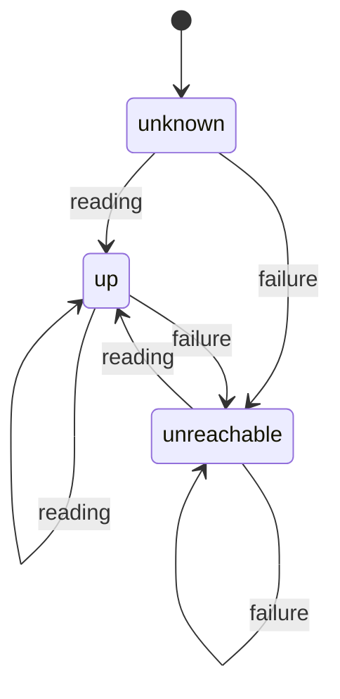

# Homelab servers

Extend Pulsebar to show the health of homelab servers — CPU, RAM, VRAM, uptime, load, disk, network — in the panel, next to the Mac's own numbers.

## Intent

| | |
| --- | --- |
| Outcome | Open the panel and see at a glance whether each homelab server is up and how loaded it is, including GPU memory on the LLM box |
| Who | The same single developer; servers are on the home LAN |
| Success | Every configured server has a row with live CPU / RAM / VRAM / uptime; expanding it shows 5-minute tracks aligned with the local tracks; an unreachable server says so without noise |

### Decided

- Data source: Prometheus **node_exporter** on each server (`:9100/metrics`), no Pulsebar agent.
- GPU: AMD Radeon AI PRO R9700 (discrete, 32 GB). VRAM comes from node_exporter's `drm` collector, enabled with `--collector.drm`.
- Reach: **LAN only**. Away from home, servers are simply unreachable.
- Surface: **panel only**. Menu bar label and notifications stay about this Mac.
- Layout: compact row per server, **expandable** into tracks and details.
- Polling: **always, every 10 s**, with backoff while unreachable.
- Configuration: **Settings UI**, stored in UserDefaults.

### Assumed

- A handful of Linux servers (2–6).
- History is in memory only, 5 minutes, like local history.

### Out of scope

- Per-process or per-container culprits on servers.
- NVIDIA / Intel GPUs, other exporters (Netdata, Glances), central Prometheus.
- Menu bar marker, notifications, authentication, TLS client certificates.

## Data

### Fetch

`GET <url>?collect[]=cpu&collect[]=meminfo&collect[]=loadavg&collect[]=stat&collect[]=time&collect[]=filesystem&collect[]=netdev&collect[]=drm`

The `collect[]` filter makes node_exporter run only these collectors, so the body is a few KB instead of ~100 KB. If the configured URL already has a query, the parameters are appended. node_exporter answers 400 when `collect[]` names a disabled collector (`disabled collector: drm`), so a 400 is retried once without `drm`.

### Prometheus text parser (`PulsebarKit/PrometheusText.swift`)

`PrometheusText.parse(_ bytes: [UInt8]) -> [MetricSample]` where `MetricSample` is `name`, `labels: [String: String]`, `value: Double`.

- Skips `#` lines and blank lines; skips malformed lines instead of failing the whole body.
- Handles label values with escaped `\"`, `\\`, `\n`; values `NaN`, `+Inf`, `-Inf`; an optional trailing timestamp.

### Server reading (`PulsebarKit/NodeMetrics.swift`)

`NodeMetrics(samples:)` maps samples to one reading. Any missing metric is `nil` and renders as `—`; it never turns the server into an error.

| Field | Metric(s) |
| --- | --- |
| CPU ticks | `node_cpu_seconds_total`, summed per `mode` across CPUs; busy = everything but `idle`, `iowait` |
| Cores | count of distinct `cpu` labels on `node_cpu_seconds_total` |
| Memory used / total | `node_memory_MemTotal_bytes − node_memory_MemAvailable_bytes`, `node_memory_MemTotal_bytes` |
| Swap used / total | `node_memory_SwapTotal_bytes − node_memory_SwapFree_bytes`, `node_memory_SwapTotal_bytes` |
| Load | `node_load1`, `node_load5`, `node_load15` |
| Uptime | `node_time_seconds − node_boot_time_seconds` (both from the server's clock, so Mac/server clock drift doesn't matter) |
| Root disk | `node_filesystem_avail_bytes`, `node_filesystem_size_bytes` with `mountpoint="/"` |
| Network bytes | `node_network_receive_bytes_total`, `node_network_transmit_bytes_total`, excluding `lo`, `veth*`, `docker*`, `br-*`, `virbr*` |
| GPUs | per `card`: `node_drm_memory_vram_used_bytes`, `node_drm_memory_vram_size_bytes`, `node_drm_memory_gtt_used_bytes`, `node_drm_memory_gtt_size_bytes`, `node_drm_gpu_busy_percent` |

Metric names for `drm` were checked against `collector/drm_linux.go` in node_exporter `master`.

### Derived values (between two readings)

- **CPU %**: busy-tick delta ÷ total-tick delta, using the same logic as the local `CPUTicks`.
- **Network rates**: `CounterRate`, as for local network.
- A counter that goes backwards (server reboot) yields `nil` for that sample — a gap, never a negative or huge spike.

## Polling and state

`HomelabMonitor` (actor, `PulsebarKit`) owns one `URLSession` (ephemeral, 3 s timeout, no cache) and the per-server state.



- `ServerState`: `.unknown`, `.up(reading)`, `.unreachable(lastSeen: Date?, reason: FailureReason)`.
- `FailureReason`: timeout, connection refused / host not found, HTTP status, body over 2 MB, not node_exporter (no `node_cpu_seconds_total`), local network permission denied.
- Every server is fetched in parallel every **10 s**. After **3** consecutive failures a server is polled every **60 s**; one success returns it to 10 s. Backoff logic is a pure value type with the clock passed in.
- Opening the panel polls immediately any server whose last poll is older than 10 s (same pattern as Docker).
- **History**: one `RingBuffer` of **30** points per server (5 min at 10 s) holding CPU %, RAM %, GPU busy % and VRAM % (fullest card). A failed poll appends an empty point so the tracks show the outage as a gap.
- State is keyed by the server's stable `id` (UUID): renaming keeps history, removing drops it. Settings changes restart the loop.
- `StatsStore` runs the loop as its own task, like `pollDocker`, and publishes states into `PanelModel.servers`.

### Track axis

`TrackGraph` and `TimelineAxis.minuteTicks` currently derive time from `capacity` assuming 2 s per sample. They take the sample interval explicitly, so a 30-point server track and the 150-point local tracks span the same 5 minutes with the same minute ticks.

## Panel UI

> [!warning] Replaced
> The collapsed and expanded rows below are replaced by the server cards in [[#Server cards (revision 2026-10-13)]]. Nothing homelab-related remains inside the panel.

A **Homelab** section between the Apps list and the footer, shown only when at least one server is configured.

### Collapsed row

```
▸ ● llm-box   CPU 64%  RAM 78%  VRAM 91%  up 4d
▸ ● nas       CPU 12%  RAM 41%            up 23d
▸ ○ pi-hole   unreachable · last seen 3 min ago
```

- Dot: green up, grey unreachable or unknown.
- Values ≥ 90% turn orange (same idea as the app row's "more than one core").
- Monospaced digits, fixed columns; a server without a GPU leaves the VRAM column empty.
- With several GPUs, the VRAM column shows the fullest card.
- Never reached: `never reached`. Tooltip carries the failure reason.

### Expanded row

One server expanded at a time, independent of the expanded app.

- Tracks: `cpu`, `ram`, and when a GPU is present `gpu` (busy %) and `vram`, reusing `TrackRow` / `TrackGraph` at a smaller height on the shared 5-minute axis.
- Details:
  - `load 3.2 2.8 2.1 / 16 cores · swap 0.4 GB`
  - `/ 61% free · ↓ 2 MB/s ↑ 140 KB/s`
  - `VRAM 29.1/32 GB · GTT 0.2 GB` per card. On a discrete card GTT near zero is normal; growth means the model spilled into system RAM.
- Ends with **Open in browser** (the server's `/metrics` URL).

### Accessibility

- Row: "llm-box, up 4 days, CPU 64%, memory 78%, VRAM 91%, collapsed" / "pi-hole, unreachable, last seen 3 minutes ago".
- Each track is one VoiceOver element: name, current value, 5-minute range, as today.

### Design contract

Superseded: the first viewport has no Homelab section; see the revision below.

## Server cards (revision 2026-10-13)

Servers are a **deck of cards** hanging under the Pulsebar panel, drawn in SwiftUI inside ONE borderless window.

- The window is a non-activating `NSPanel` (never key), attached as a child `.below` the `MenuBarExtra` panel, so it moves with it and interacting with it does not dismiss the panel. It exists only while the panel is open and at least one server is configured, and follows `panel.servers` live.
- Width and x match the panel. Its top edge is 10 pt above the panel's bottom edge: that transparent margin hides behind the panel and holds no content.
- **Collapsed**: each card is a 30 pt strip (dot, name, CPU %, RAM %, VRAM % with a GPU, uptime; or `unreachable · last seen …`; ≥90% orange). Cards sit 5 pt apart, the first 5 pt below the panel.
- **Open** (hover): the card grows downward in place; its strip stays as the header, the full server view (tracks, details, **Open in browser**) is below, and later strips move down. One open at a time. `withAnimation(.easeOut(0.18))`, none with Reduce Motion.
- **Window sizing**: top fixed. The window grows to the target height before the animation and shrinks after it. A deck taller than the space down to the screen's `visibleFrame.minY` caps the open card's details in a `ScrollView`.
- **Hover** is a hosting-view `NSTrackingArea` (`.activeAlways`, `.inVisibleRect`) reporting the pointer; cards report their frames to a shared state and the stack hit-tests. The panels are never key, and `.activeAlways` is the only documented way to receive tracking events then. Leaving all cards collapses after 150 ms; moving to another card swaps at once.
- **Look**: the same surface as the panel. At window creation the stack copies `material`, `blendingMode`, `isEmphasized`, the corner radius (fallback 10 pt) and `effectiveAppearance` from the panel's `NSVisualEffectView` (fallback `.popover`, `.behindWindow`) into one `NSVisualEffectView` per card. `.behindWindow` blending means each card samples the desktop, not the card beneath. Edge: a 1 pt outline (white 15% in dark, `separatorColor` in light). The window has the system shadow (`hasShadow`), re-derived with `invalidateShadow()` after every resize.
- Accessibility: one element per card with the old row label, plus actions **Show details** / **Hide details** and **Open in browser**.
- `CardDeck` in `PulsebarKit` holds the pure window placement and height limit; `ServerCardStack` owns the window.

## Settings

A **Servers** section:

- One row per server: name, URL, **Test**, remove. **Add server** below the list.
- Bare host input is normalised: `nas.lan` → `http://nas.lan:9100/metrics`; `nas.lan:9200` → `http://nas.lan:9200/metrics`. Only `http` / `https` with a host are accepted; invalid input is shown inline and not saved.
- **Test** fetches once and shows one line:

| Result | Text |
| --- | --- |
| OK with GPU | `OK · node_exporter, 16 cores, 1 GPU` |
| OK without `drm` | `OK · no GPU metrics — start node_exporter with --collector.drm` |
| Not node_exporter | `Not node_exporter (no node_cpu_seconds_total)` |
| Timeout | `Timed out after 3 s` |
| Refused / DNS | `Can't connect to nas.lan:9100` |
| Local network denied | `Blocked by Local Network permission — allow Pulsebar in System Settings › Privacy & Security › Local Network` |

- Stored as one JSON array of `{id, name, url}` under the UserDefaults key `servers`.

## Platform

`Support/Info.plist` gains:

- `NSAppTransportSecurity` → `NSAllowsArbitraryLoads = true`. ATS otherwise blocks plain `http://` to LAN names like `nas.lan`. Pulsebar only fetches URLs the user typed.
- `NSLocalNetworkUsageDescription`: "Pulsebar reads metrics from your homelab servers."

> [!warning] node_exporter is unauthenticated
> It serves metrics over plain HTTP to anyone who can reach port 9100. The README tells users to firewall it to the LAN and never expose it to the internet.

## Testing

swift-testing in `Tests/PulsebarKitTests`, run with `make test`.

| Unit | Cases |
| --- | --- |
| `PrometheusText` | labels with escapes, comments, blank lines, `NaN` / `±Inf`, timestamps, malformed lines skipped, empty input |
| `NodeMetrics` | captured real node_exporter body with and without `drm`; missing metrics → `nil`; virtual interfaces excluded; uptime; core count; fullest GPU picked |
| CPU % / rates | two readings, counter reset → `nil` |
| Backoff | 3 failures → 60 s, success → 10 s, injected clock |
| Server URL | bare host, host:port, full URL kept, query appended, invalid rejected |

No live-HTTP tests and no `URLSession` mocking; the network edge is kept thin and the logic around it is pure.

## Documentation

- `README.md`: Homelab section — install (`apt install prometheus-node-exporter`), enable `--collector.drm`, firewall to LAN, what each number means, Settings.
- `PRODUCT.md`: capabilities and operating context (10 s background polling).
- `docs/design-contract.md`: first viewport change above.

## Files

| File | Change |
| --- | --- |
| `Sources/PulsebarKit/PrometheusText.swift` | new parser |
| `Sources/PulsebarKit/NodeMetrics.swift` | new reading + derived values |
| `Sources/PulsebarKit/ServerConfig.swift` | `{id, name, url}`, URL normalisation |
| `Sources/PulsebarKit/HomelabMonitor.swift` | actor, URLSession fetch, state, history, backoff |
| `Sources/Pulsebar/StatsStore.swift`, `PanelModel.swift` | homelab loop, `servers` state, expanded server |
| `Sources/Pulsebar/HomelabList.swift` | new section: rows, expansion |
| `Sources/Pulsebar/TrackGraph.swift`, `TrackRow.swift` | explicit sample interval (`TimelineAxis` lives in `TrackRow.swift`) |
| `Sources/Pulsebar/PopoverView.swift` | insert section |
| `Sources/Pulsebar/SettingsView.swift` | Servers section |
| `Support/Info.plist` | ATS + local network keys |
